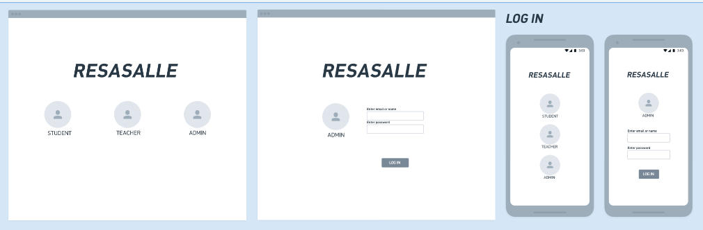
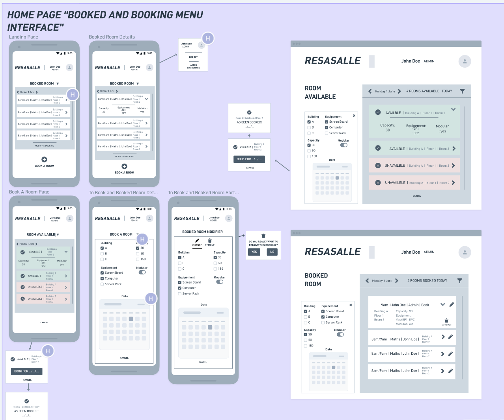
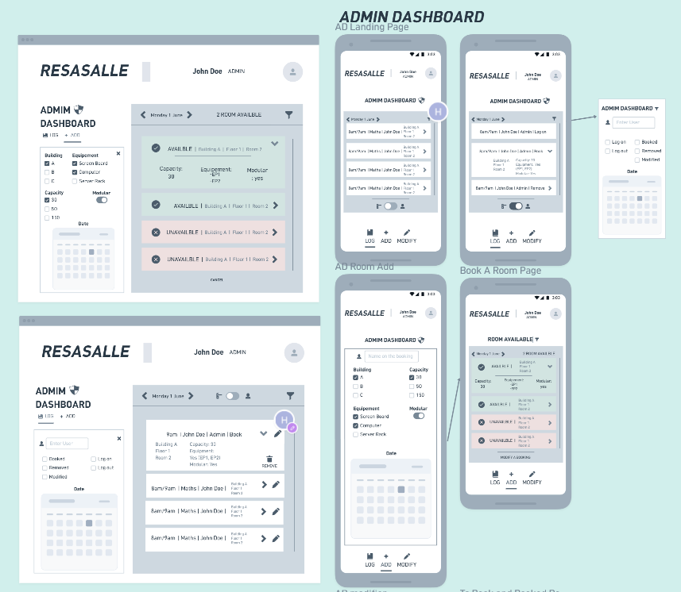
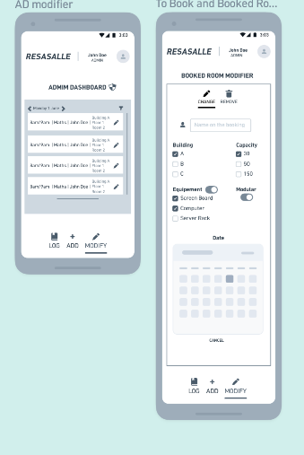
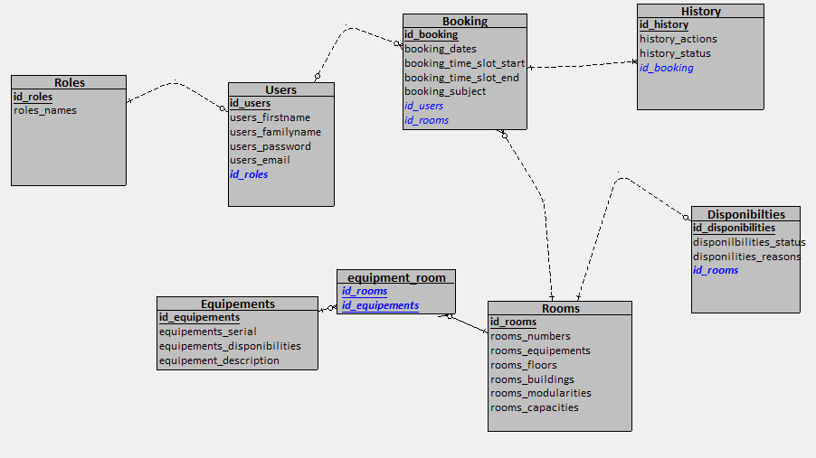
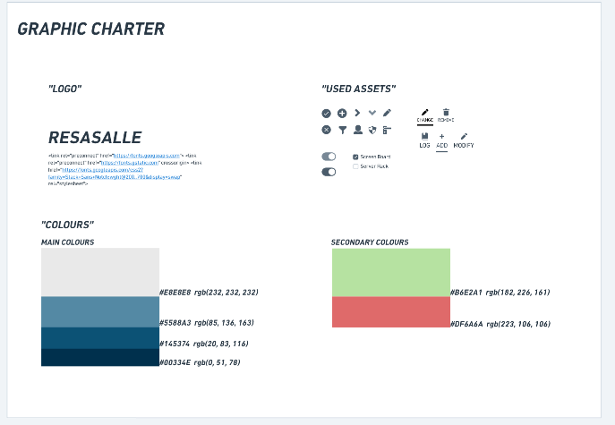
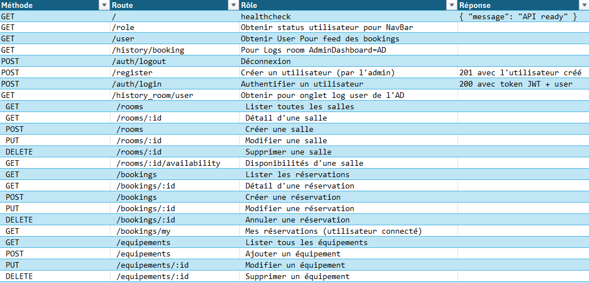

# Resasalle

Application web de **réservation de salles** pour un établissement scolaire. Elle permet aux enseignants et au personnel administratif de visualiser les salles disponibles, de réserver un créneau, et de suivre l'historique des actions.

## Acteurs

| Acteur | Rôle |
|---|---|
| **Admin** | Gère les utilisateurs, les salles, les équipements. Accès à tout l'historique. |
| **Teacher** | Réserve des salles pour ses cours. Consulte ses réservations. |
| **Student** | Voit le planning des salles (lecture seule). |

## Stack technique

| Couche | Technologie |
|---|---|
| Frontend | Vue 3 + TypeScript + Vite + Tailwind CSS 4 + Vue Router |
| Backend | Node.js + TypeScript + Express 5 |
| ORM | TypeORM (MariaDB) |
| Auth | JWT (jsonwebtoken) + cookies |
| Base de données | MariaDB |
| Lint | Biome |
| Tests | Jest + ts-jest |
| Outils | ts-node, nodemon |

## État d'avancement

| Bloc | État | Commentaire |
|---|---|---|
| Authentification (backend) | ✅ Fait | Register, login/logout (cookie JWT), profil `/me` |
| Salles (backend) | ✅ Fait | Recherche filtrée, options de filtres, disponibilités |
| Réservations (backend) | ✅ Fait | Création avec vérification des conflits, feed du jour |
| Administration (backend) | ❌ TODO | CRUD utilisateurs/salles et historique non implémentés |
| BDD (migrations + seeders) | ⚠️ Écrits, non exécutés | 2 migrations et 4 seeders présents, aucune commande scriptée |
| Configuration `.env` | ⚠️ Incomplet | Seul `PORT` est défini — `JWT_SECRET` manque |
| Frontend – UI | ✅ Fait | Login, accueil, recherche, résultats, dashboard admin |
| Frontend – intégration API | ❌ TODO | Aucun appel réseau : le frontend est encore statique |
| Garde des routes | ❌ TODO | Aucune protection des routes par rôle |
| Tests | ⚠️ Partiel | Un seul test (hash bcrypt), non connecté aux services |

## Fonctionnalités

### Authentification

| Fonctionnalité | Acteurs | État | Description |
|---|---|---|---|
| Inscription | Admin | ✅ | Création d'un utilisateur avec un rôle (Student, Teacher, Admin) |
| Connexion / Déconnexion | Tous | ✅ | Authentification JWT (cookie) avec enregistrement dans l'historique |
| Profil connecté | Tous | ✅ | Récupération des infos utilisateur (nom, email, rôle) |

### Salles

| Fonctionnalité | Acteurs | État | Description |
|---|---|---|---|
| Recherche filtrée | Teacher, Student | ✅ | Filtrage par bâtiment, étage, capacité, équipements |
| Disponibilités | Teacher, Student | ✅ | Liste des salles libres pour un créneau donné |

### Réservations

| Fonctionnalité | Acteurs | État | Description |
|---|---|---|---|
| Création de réservation | Teacher | ✅ | Réservation avec vérification des conflits horaires (409 en cas de conflit) |
| Feed du jour | Tous | ✅ | Affiche toutes les réservations du jour triées par horaire |

### Administration

| Fonctionnalité | Acteurs | État | Description |
|---|---|---|---|
| Gestion utilisateurs | Admin | ❌ TODO | CRUD complet des utilisateurs |
| Gestion salles | Admin | ❌ TODO | CRUD des salles et équipements |
| Historique | Admin | ❌ TODO | Trace de toutes les actions (login, logout, réservation) |

## Prérequis

- Node.js ≥ 18
- npm ≥ 9
- MariaDB

## Installation et lancement

### 1. Cloner le projet

```bash
git clone git@github.com:hugo-glt/RESASALLE.git
cd resasalle
```

### 2. Backend

```bash
cd backend
npm install
```

Configurer le fichier `.env` à la racine du backend :

```env
PORT=8000
JWT_SECRET=une_cle_secrete_longue
```

> **Note :** la connexion à la base de données est actuellement configurée directement dans `backend/src/database/data-source.ts` (host, port, utilisateur, mot de passe, nom de la base). Adaptez-la à votre environnement MariaDB.

Puis lancer en développement :

```bash
npm run dev
# API démarrée sur http://localhost:8000
```

### 3. Frontend

```bash
cd ../frontend
npm install
npm run dev
# Application démarrée sur http://localhost:5173
```

> **Note :** n'exécutez pas `npm install` à la racine du projet — le `package.json` racine est un résidu sans rapport avec le projet.

## Base de données

- 2 migrations TypeORM : `backend/src/database/migrations/`
- 4 seeders (rôles, utilisateurs, salles, équipements) : `backend/src/database/seeders/`

Exécuter les migrations :

```bash
cd backend
npx typeorm-ts-node-commonjs migration:run -d src/database/data-source.ts
```

Puis lancer les seeders manuellement (aucun script npm dédié pour l'instant) :

```bash
npx ts-node src/database/seeders/rolesseeds.ts
npx ts-node src/database/seeders/usersseeds.ts
npx ts-node src/database/seeders/roomsseeds.ts
npx ts-node src/database/seeders/equipementsseeds.ts
```

## API

Base URL : `http://localhost:8000`

### Authentification

| Méthode | Endpoint | Auth | Description |
|---|---|---|---|
| POST | `/register` | — | Création d'un utilisateur (rôle via `id_roles`) |
| POST | `/login` | — | Connexion, retourne le token (cookie) |
| POST | `/logout` | — | Déconnexion, efface le cookie |
| GET | `/me` | ✅ | Profil de l'utilisateur connecté |

### Salles

| Méthode | Endpoint | Auth | Description |
|---|---|---|---|
| GET | `/rooms/search` | ✅ | Recherche filtrée (bâtiment, étage, capacité, équipements) |
| GET | `/rooms/filters` | ✅ | Options disponibles pour les filtres |

### Réservations

| Méthode | Endpoint | Auth | Description |
|---|---|---|---|
| POST | `/bookings` | ✅ | Création d'une réservation (409 si conflit horaire) |
| GET | `/bookings/available` | ✅ | Salles libres pour un créneau (`date`, `timeslotstart`, `timeslotend`) |
| GET | `/bookings/today` | ✅ | Feed des réservations du jour |

### Administration — ❌ TODO

| Méthode | Endpoint | Description |
|---|---|---|
| GET/POST/PUT/DELETE | `/users` | CRUD des utilisateurs |
| GET/POST/PUT/DELETE | `/rooms` | CRUD des salles et équipements |
| GET | `/history` | Historique des actions |

## Tests et lint

```bash
cd backend
npm test              # Jest
npm run test:watch
npm run test:coverage
npx @biomejs/biome check src   # Lint (Biome)
```

> Le script `npm run lint` (ESLint) échouera : aucun fichier de configuration ESLint n'existe. Utilisez Biome.

## Structure du projet

```
resasalle/
├── backend/
│   ├── src/
│   │   ├── app.ts                  # Point d'entrée Express
│   │   ├── config/                 # env, constantes
│   │   ├── controller/             # UserController, RoomController, BookingController
│   │   ├── routes/                 # Routes API
│   │   ├── services/               # UserService, RoomService, BookingService
│   │   ├── repositories/           # UserRepository
│   │   ├── entities/               # Entités TypeORM (users, rooms, booking...)
│   │   ├── middleware/             # authentificate (JWT)
│   │   └── database/               # data-source, migrations, seeders
│   ├── test/                       # Tests Jest
│   ├── .env                        # Variables d'environnement
│   └── package.json
├── frontend/
│   ├── src/
│   │   ├── views/                  # Login, HomePage, Search/Result, Dashboard
│   │   ├── layouts/                # NavBar
│   │   ├── router/                 # Routes Vue Router
│   │   ├── composables/            # Stores partagés
│   │   └── assets/                 # Icons, images
│   └── package.json
└── documentation/                  # Wireframes, charte, MLD
```

## Documentation

| Document | Fichier |
|---|---|
| Login Wireframe |  |
| User / Homepage Wireframe |  |
| Admin Dashboard Wireframe 1 |  |
| Admin Dashboard Wireframe 2 |  |
| Schéma de base de données |  |
| Charte graphique |  |
| Endpoints |  |

## Roadmap

- [ ] Intégrer le frontend à l'API (client axios, login réel, store utilisateur)
- [ ] Proteger les routes Vue par rôle (garde de navigation)
- [ ] Implémenter les endpoints admin (CRUD utilisateurs, CRUD salles, historique)
- [ ] Compléter le `.env` (`JWT_SECRET`) et externaliser la config BDD depuis `data-source.ts`
- [ ] Scripter l'exécution des migrations et seeders (scripts npm)
- [ ] Écrire des tests connectés aux services (UserService, BookingService)
- [ ] Supprimer la nav temporaire de `App.vue` et le `package.json` racine
- [ ] Corriger le casse du fichier `NavBar.Vue` → `NavBar.vue`